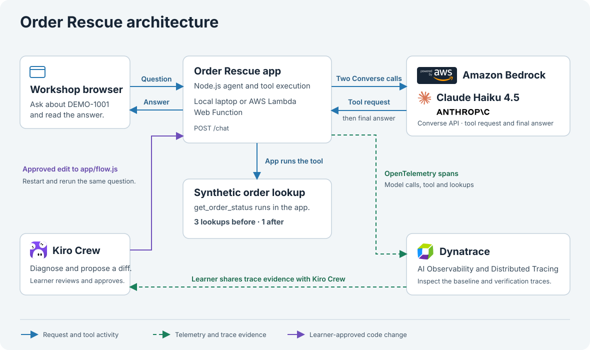

# Order Rescue Lite

A tiny, observable AI agent with a planted defect you fix live. An order-support
agent answers a question about synthetic order `DEMO-1001` by calling one tool on
Amazon Bedrock. The tool reads the backend **three times** when **once** would
do. You see the waste on the page and in the trace, have an AI assistant fix one
file, redeploy, and watch it drop to a single read.

It teaches three things working together:

- **Amazon Bedrock (Claude)** — the model that decides to call the tool.
- **OpenTelemetry → your observability backend** (e.g. Dynatrace) — shows the waste.
- **Your AI coding assistant** (KiroCrew, …) — finds and fixes it, then redeploys.

```
  demo page  ->  agent (Bedrock Converse tool use)  ->  Bedrock (Claude)
                      |
                      +-- order lookup  (3 reads -> fix to 1)
                      |
                      +-- OpenTelemetry spans -> your Dynatrace tenant
```

The same Node app runs **locally** (loopback only) and **in AWS** on a
**Lambda Web Function** (Node.js 24). No servers, no containers, no SAM.

> **Running the guided demo (one or more laptops)? See [RUNBOOK.md](RUNBOOK.md)**
> — or [QUICKSTART.md](QUICKSTART.md) to test the whole loop in ~5 minutes.
> Both are safe to hand to any AI assistant.
>
> **Using an AI agent?** Open this folder in it and say *"walk me through the demo"*.
> [AGENTS.md](AGENTS.md) tells the agent how to run it locally or on AWS, verify it,
> reset it, and clean up.

For live mode, use your own AWS credentials and Dynatrace environment. Set
`AWS_EXPECTED_ACCOUNT_ID` in your local `.env` to verify the active AWS account.
Set your Dynatrace endpoint and ingest header in the same file, or run setup to
configure them interactively. The Node.js laptop workflow does not use EC2
instance IDs.

## Architecture



The local Node.js app or Lambda Web Function serves the page, calls Bedrock,
and reads a synthetic order. It exports OpenTelemetry spans to Dynatrace. Deploy uses the native
`aws lambda-web` CLI — one Web Function per **lane**. Each lane namespaces its
function, log group, and demo branch, so many lanes share one AWS account
without colliding.

## Quick start — local, no AWS needed

```bash
git clone https://github.com/enl1104/Reinvent-order-rescue-workshop-public.git
cd Reinvent-order-rescue-workshop-public/app
npm install
MODEL_MODE=mock ORDER_DELAY_MS=400 npm start
```

Open http://127.0.0.1:8080 and click **Ask the agent**. `mock` mode needs no
credentials — a deterministic stand-in model — so you see the flow and the
**3 backend reads (red)** immediately. Run the tests that prove 3 → 1:

```bash
npm test
```

## Run it for real (Claude on Bedrock)

Needs AWS credentials in your shell (`aws sso login`, `AWS_PROFILE`, env vars) and
access to the Bedrock model in your region.

```bash
cd app
MODEL_MODE=bedrock AWS_REGION=us-east-1 npm start
```

Still 3 reads — the defect is in the code, not the model.

### See the trace in Dynatrace (optional)

```bash
export OTEL_EXPORTER_OTLP_TRACES_ENDPOINT=https://TENANT.live.dynatrace.com/api/v2/otlp/v1/traces
export OTEL_EXPORTER_OTLP_TRACES_HEADERS='Authorization=Api-Token%20dt0c01.XXXXXXXX'
```

Use an ingest token with scope `openTelemetryTrace.ingest`. One trace per request:
`invoke_agent` → two `chat` spans → one `execute_tool` → **three** `orders.lookup`
spans. (Mind the `%20` — OTEL header values are URL-encoded; a literal space 401s.)

## The exercise

1. Ask the agent; note **3 backend reads**.
2. Open [`app/flow.js`](app/flow.js) — `buildContext` calls `lookup` three times.
   Have your AI assistant make it read **once** while returning all four fields,
   or compare [`solution/flow.js`](solution/flow.js).
3. Restart and ask again — **1 backend read**, same answer.

## Deploy to AWS (native `aws lambda-web` CLI)

No SAM, no CloudFormation. `aws lambda-web deploy` creates the function, its
public endpoint, a managed S3 bucket, and (first run) the shared execution role.

```bash
bash scripts/setup.sh              # writes .env: seat + this laptop's Dynatrace tenant
bash scripts/deploy.sh             # builds + deploys this seat; prints the public URL
```

`setup.sh` is interactive (lane id, Dynatrace tenant, ingest token — validated
before writing `.env`). The scripts read your account and region from the AWS CLI,
so the same or different accounts both work. Full walkthrough: [RUNBOOK.md](RUNBOOK.md).

Tear a seat down when finished (seat names are random, so the script discovers them):

```bash
bash scripts/teardown.sh          # this laptop's seat
bash scripts/teardown.sh --all    # every seat in the account (fleet cleanup)
```

## Security

- **Local runs bind `127.0.0.1` only** — not reachable from other machines.
- **The deployed endpoint is public and anonymous** (`AuthType:
  ApplicationManaged`) so a browser button can call it without SigV4. This invokes
  Bedrock in your account per click. It is bounded (only `DEMO-1001`, ≤96 output
  tokens per model call, ≤4 model + 4 tool calls, 4 KB body, endpoint rate limit 100, ≤2
  environments) for a **short, watched demo** — tear it down or set `RateLimit` to
  0 afterwards. For anything longer-lived use `IamAuth` + CloudFront, or Midway.
- The deploy package excludes `.env`, `*.pem`, and `*.key` automatically; the code
  bucket is the CLI's AWS-managed bucket (not public).
- No secrets in the repo. `.env` and Dynatrace tokens are gitignored; the OTLP
  token is passed at deploy time (or a CI secret). The Bedrock policy grants only
  `bedrock:InvokeModel` — scope `Resource` to specific model ARNs for longer use.

## Layout

```
app/flow.js         the defect — the one file you edit
app/orders.js       synthetic backend; one lookup() = one read (one span)
app/agent.js        bounded Bedrock Converse tool-use loop (+ mock model)
app/telemetry.js    optional OpenTelemetry -> OTLP export
app/service.js      wires it together; counts reads, returns the result
app/server.js       node:http server (loopback locally, Web Functions in AWS)
app/public/index.html  the demo page
solution/flow.js    the validated one-read fix
scripts/setup.sh       write .env (seat + Dynatrace tenant), validate token
scripts/deploy.sh      build + deploy a seat via `aws lambda-web deploy`
scripts/teardown.sh    delete one seat, or discover + delete the whole fleet
RUNBOOK.md             the guided demo runbook
```
